**Name:** Julien Bourgeois

This project trains a small velocity network to carry Gaussian noise onto a target cloud. The training path is the straight line used in Flow Matching for Generative Modeling. Part 3 asks the question from Flow Straight and Fast: Learning to Generate and Transfer Data with Rectified Flow: can one round of reflow straighten that transport and keep the sample quality with fewer network evaluations?

The PDF of this same write-up is [report.pdf](report.pdf). The animation is in Part 2.

Time 0 is noise and time 1 is data. A training pair uses x_t = (1 - t) x_0 + t x_1 and the target velocity u = x_1 - x_0. The loss is the mean of ||v(x_t, t) - u||^2 over the batch. At generation the network sees only (x_t, t). It does not receive x_1. The sampler is explicit Euler: z starts at a fresh Gaussian draw, and z next equals z plus dt times v(z, t), with t_k = k / n_steps and dt = 1 / n_steps. The network is evaluated at the start of each step, so a run with P particles and K steps costs P times K evaluations.

## Setup

The run device is cpu. CUDA was not available. MPS was available and was not used. Python packages in the banner were torch 2.14.0, numpy 1.23.5, and matplotlib 3.7.2. The network is an MLP with input (x, y, t), three hidden layers of width 128, SiLU activations, and a 2D velocity output. The parameter count printed by the scripts is **33794**. The optimizer is Adam with learning rate 0.001 and batch size 256. Part 1 uses seed 0 and 12000 steps. Part 2 uses seed 7 and 20000 steps. Part 3 repeats the letter experiment on seeds 7, 21, 42. Three seeds is a small check, not a large sweep.

Parts 2 and 3 share one histogram. It has 32 by 32 bins on the square [-3.5, 3.5], so the bin width is 0.21875. One extra overflow bin counts every point that falls outside that square. Points in the overflow bin are kept in the score. Each comparison uses 8000 generated points and 8000 points from one frozen letter sample, seed 20262. The held-out Gaussian is seed 20261 and is not the set of reflow training sources. The score is the L1 distance between the two normalized histograms. It does not pair a generated point with a target point. A second independent letter sample, seed 20263, scores L1 **0.1220** against the frozen reference. That number is the bin noise of this grid and this sample size. Every model below is scored against the same reference.

## Part 1: Gaussian to a ring

### Task 1: Straight training paths

The source is a standard 2D Gaussian. The target is a thick ring with inner radius 1.20 and outer radius 2.10. The angle is uniform on [0, 2 pi). The squared radius is uniform between the squared edges, which spreads the points evenly in area. A target point stays inside radius 2.10. Each training pair is one Gaussian draw and one ring draw. They are matched only by the order they were drawn. t is uniform on (0, 1).

The first path in the figure starts at (-0.5108, 1.0283) and ends at (-1.4724, 0.3994). The velocity u = x_1 - x_0 is (-0.9616, -0.6289). Splitting that segment into four equal times gives four displacements. The largest absolute difference among those four vectors is 1.192e-07. Along the segment, dx/dt = x_1 - x_0, and that difference does not contain t. The velocity on a training segment is constant, and the marks on each path are equally spaced.

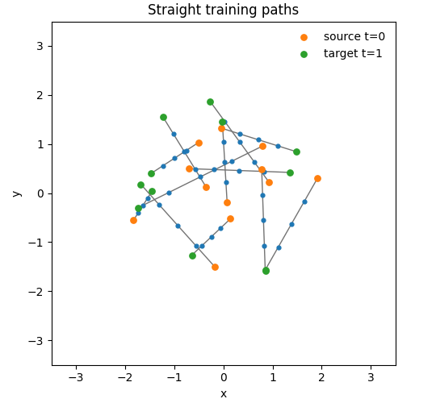

*Twelve independent training pairs. Orange is the Gaussian source, green is the ring, and the blue marks split each segment into equal time steps.*

### Task 2: Training

Training took 16.052 seconds for 12000 steps. The first batch loss is 4.7361. The mean of the last 500 batch losses is 3.4847. On 20,000 independent pairs, the mean of ||x_1 - x_0||^2 is 4.9096. A network that predicts the zero velocity would sit near that number. The trained mean, 3.4847, is lower, and it is still far from zero. The loss does not have to go to zero. Each pair is one random match. Different targets can be tied to sources that pass near the same point at the same time, and those pairs ask for different velocities. The network only sees (x, t), so the value it can fit is an average. The squared error of that average stays positive. The curve in the figure flattens in that range.

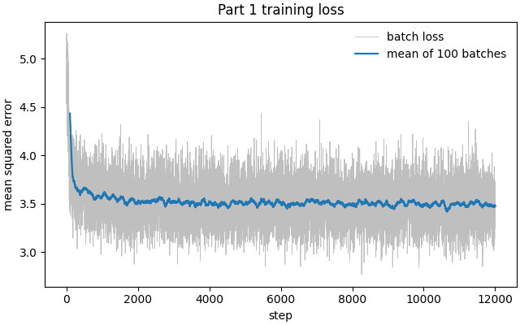

*Part 1 batch loss. The pale line is one batch. The blue line is a 100-batch mean.*

### Task 3: Generation without endpoints

Generation starts from 4000 fresh Gaussian points, seed 11. The integration uses 100 Euler steps. No ring endpoint is passed to the network. The wall time for that integration, including the stored trajectory and excluding the plots, is 0.3146 seconds. The evaluation count is 400000. The fraction of points inside the annulus is 1.0000 for the target sample, 0.3790 for the Gaussian source, and 0.9455 for the generated cloud at t = 1. On this same 32 by 32 grid, the histogram L1 between the generated cloud and the target draw is 0.2960. That comparison uses 4,000 points on each side, so it is not the 8,000-point letter score from Parts 2 and 3.

The quiver is the learned field on a 17 by 17 grid from -2.8 to 2.8. t = 0.0 has median speed 2.3539 and 80th percentile speed 2.9513. t = 0.5 has median speed 1.0534 and 80th percentile speed 1.6509. t = 1.0 has median speed 1.1671 and 80th percentile speed 1.8226. The arrow length is a shared display scale.

The learned paths use the first 2000 of those generated particles and the same 100 segments. The mean polyline length is 1.0185. The mean start-to-end distance is 0.5214. The mean excess length is 0.4972. The training segments above are straight. These Euler paths are a different object. Training is shown the endpoint and regresses toward x_1 - x_0. Generation never receives that endpoint, and the field is an average over many random pairs. Straight training paths do not imply straight learned trajectories. The checkpoint is checkpoints/part1.pt.

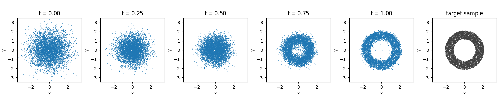

*Generated cloud at t = 0, 0.25, 0.50, 0.75, and 1.00, next to an independent ring sample. These panels use 100 Euler steps.*

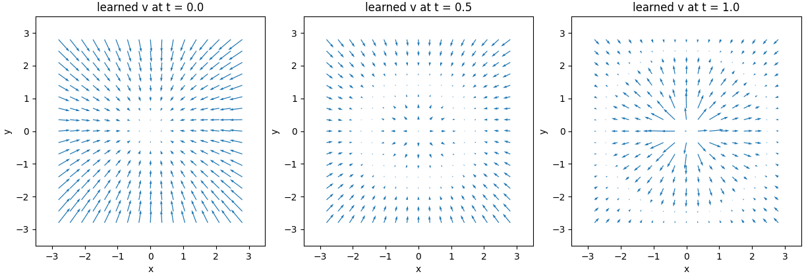

*Learned velocity on the grid at t = 0, 0.5, and 1.*

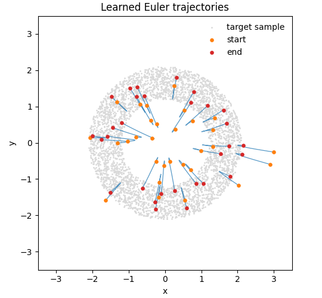

*Learned Euler trajectories. The gray points are a ring sample. Orange is t = 0 and red is t = 1 for the integrated particles.*

## Part 2: An original letter J

The Part 2 target is a thick letter J drawn in code. It is original procedural geometry. There is no downloaded image, no logo, and no external file, so there is no external asset and no license.

The stem runs from x = 0.35 to x = 1.10 and from y = -0.25 to y = 1.85. The hook is an annular sector centered at (-0.15, -0.25), with inner radius 0.50 and outer radius 1.25. The angle covers the lower half of that annulus and 0.55 radians of upward curl on the left. The sampler draws uniformly in a box just outside that geometry and keeps the points inside the letter. A sample of 20000 points has x in [-1.400, 1.100] and y in [-1.499, 1.850]. The largest radius in that sample is 2.143, and the mean radius is 1.133. This is a separate model from the ring. It uses the same architecture.

Training took 29.534 seconds for 20000 steps, seed 7. The first batch loss is 3.2345. The mean of the last 500 batch losses is 2.2997. The mean of ||x_1 - x_0||^2 on 20,000 independent pairs is 3.4172. The trained loss is below that zero-velocity level and remains well above zero, for the same reason as in Part 1. The checkpoint is checkpoints/baseline_seed7.pt.

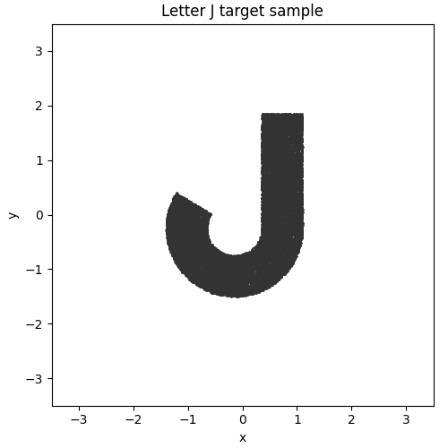

*Twenty thousand samples from the letter J sampler.*

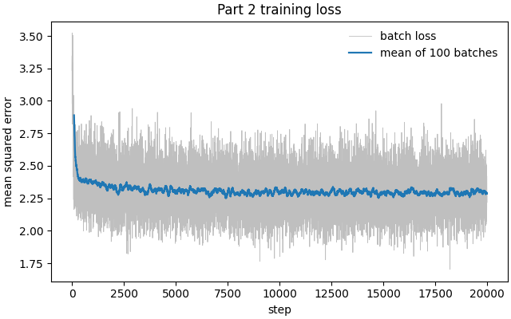

*Part 2 batch loss for the letter model, seed 7.*

### Task 2: Tracked particles

The animation follows 1800 particles from one Gaussian draw, seed 70, for 40 Euler steps. Color is the angle of the source coordinate, drawn with an HSV colormap. The color is computed once and kept on that particle. It is not an input to the network, and the network does not predict it. The six stills below are the same particles at t = 0, 0.2, 0.4, 0.6, 0.8, and 1.

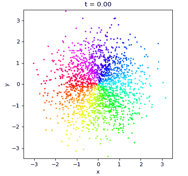

*The same particles, from noise to the letter. Color stays on the particle. It is not part of the training.*

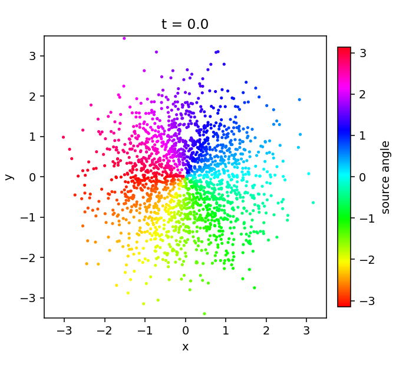

*Tracked particles, part2_still_t000.png.*

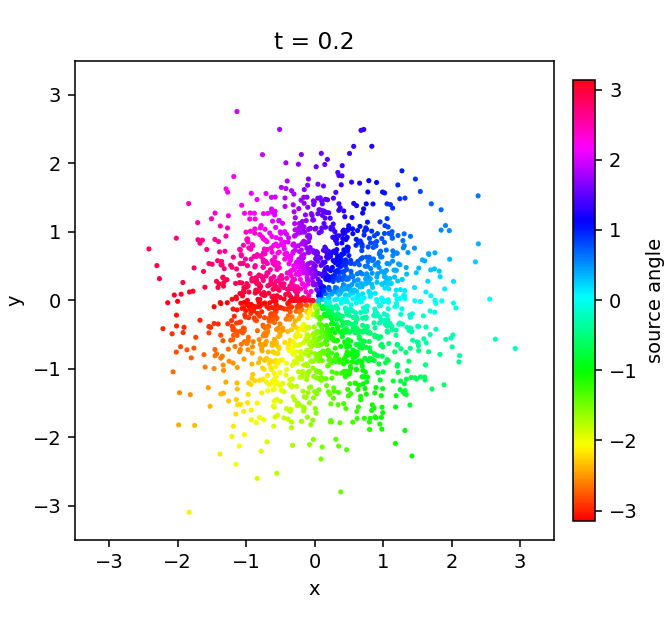

*Tracked particles, part2_still_t020.png.*

Figure. Tracked particles, part2_still_t000.png, part2_still_t020.png.

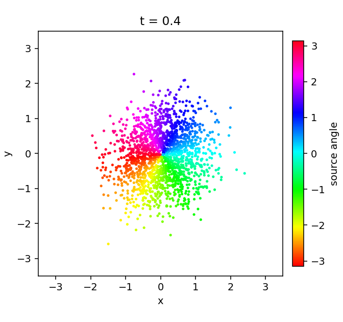

*Tracked particles, part2_still_t040.png.*

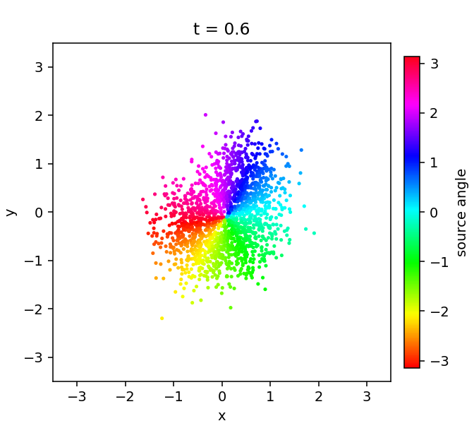

*Tracked particles, part2_still_t060.png.*

Figure. Tracked particles, part2_still_t040.png, part2_still_t060.png.

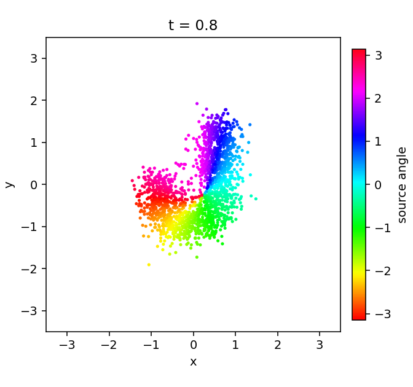

*Tracked particles, part2_still_t080.png.*

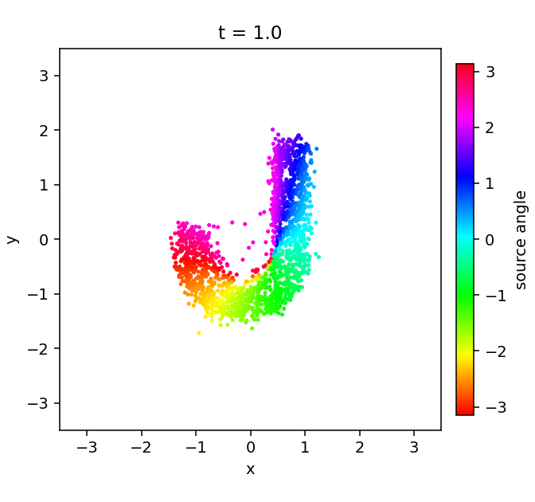

*Tracked particles, part2_still_t100.png.*

Figure. Tracked particles, part2_still_t080.png, part2_still_t100.png.

### Task 3: Euler step count

The weights and the initial Gaussian are frozen. The same 8000 held-out points are integrated with 1, 5, 10, 25, and 50 Euler steps. Sampling time is the Euler loop only. Each entry is the median of 3 repeats after one untimed warmup forward. Rendering is outside the timer. Network evaluations means particles times steps: one forward pass on one particle at one Euler time. The largest overflow fraction in this table is 0.0000, so the histogram is not dropping points outside the window.

| steps | L1 | overflow | seconds | evaluations |
| --- | --- | --- | --- | --- |
| 1 | 1.9788 | 0.0000 | 0.0049 | 8000 |
| 5 | 0.5697 | 0.0000 | 0.0268 | 40000 |
| 10 | 0.3087 | 0.0000 | 0.0406 | 80000 |
| 25 | 0.2092 | 0.0000 | 0.1012 | 200000 |
| 50 | 0.1983 | 0.0000 | 0.1903 | 400000 |

These times are the Part 2 measurement of the seed-7 baseline. Part 3 times the same baseline again, in the same process as reflow and continued training. The histogram distances match. The head-to-head table later uses the Part 3 clock.

The L1 is 1.9788 at 1 step, 0.5697 at 5, 0.3087 at 10, 0.2092 at 25, and 0.1983 at 50. Two letter draws score 0.1220 on this grid, so the 50-step cloud is still above that floor. From 1 step to 10 steps the L1 falls by 1.6700. From 25 steps to 50 steps it falls by 0.0110. The early steps remove a large integration error. The later steps move the score only a little. A finer Euler grid cannot repair a velocity that points to the wrong place, and it cannot put back detail that the independent coupling averaged away. On the shared 100-step grid, 2000 particles have mean length 0.9234, mean chord 0.5051, and mean excess 0.4183.

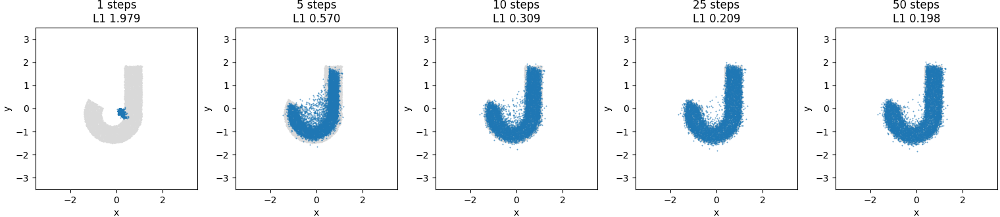

*Seed-7 baseline at 1, 5, 10, 25, and 50 Euler steps. Gray is the frozen letter sample. Blue is the generated cloud.*

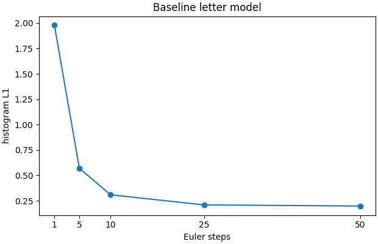

*Histogram L1 of the seed-7 baseline against the frozen letter sample.*

## Part 3: One round of reflow

### Task 1: Hypothesis, then frozen pairs

Hypothesis: one round of reflow can straighten the learned transport and keep sample quality with fewer network evaluations. This is not guaranteed. Reflow learns straight paths toward the endpoints the frozen baseline reached, so it can copy the baseline's endpoint errors. A straighter path is not the same thing as a closer match to the target.

That paragraph was written into the Part 3 log before the losses and the tables. The same paragraph is at the top of the seed-42 log, which was started later for the third seed. The measurements were not used to choose the hypothesis.

The baseline weights stay frozen while the pairs are built. Each seed draws 16384 Gaussian sources and integrates them with 100 Euler steps. Source i is saved with the endpoint that integration reached. The sources are not shuffled, and the endpoints are not replaced by fresh letter samples. That wall time is data generation. It is separate from reflow training and from the inference times below. Reflow then trains a new network, same architecture, on straight interpolations of those saved pairs. Continued training starts from the baseline weights and Adam state and takes the same number of extra steps on fresh independent letter pairs. Both extra runs use 6000 steps. The baseline itself was trained for 20000 steps.

| seed | baseline s | pair gen s | reflow s | continued s |
| --- | --- | --- | --- | --- |
| 7 | 29.534 | 0.704 | 9.550 | 10.338 |
| 21 | 30.236 | 0.885 | 8.358 | 9.251 |
| 42 | 28.939 | 0.801 | 9.022 | 10.091 |

Across the three seeds, pair generation totals 2.390 seconds, reflow training totals 26.931 seconds, and continued training totals 29.680 seconds. Each pair file holds 16384 aligned pairs and costs 1638400 network evaluations. Seed 7's baseline time is the Part 2 training run. Seeds 21 and 42 were trained inside part_3.py. Reflow's mean loss over the last 500 batches is 0.0008 on seed 7, 0.0007 on seed 21, and 0.0007 on seed 42. The letter-matching continued run stays near 2.2933, 2.2808, and 2.2979. Those two losses are squared errors on different targets. A small reflow loss means the saved pairs are easy to interpolate. It is not, by itself, a better match to the letter.

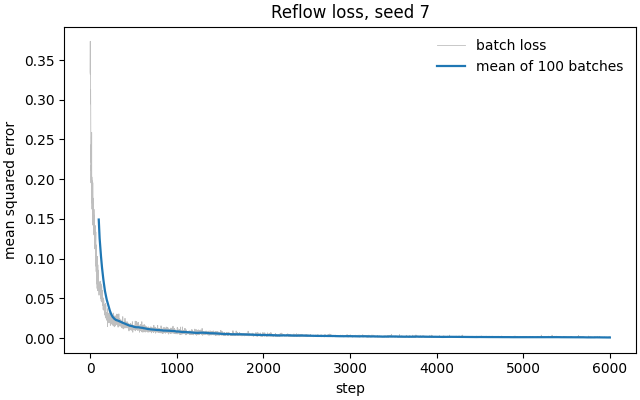

*Reflow training loss, seed 7, on the saved baseline endpoints.*

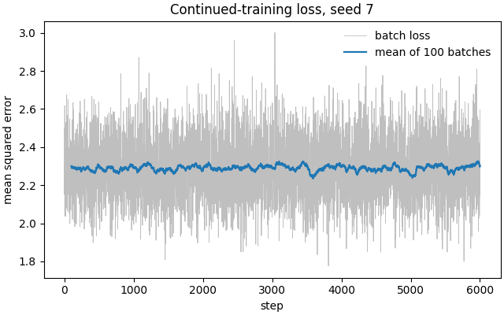

*Continued-training loss, seed 7, on fresh letter pairs. These 6,000 steps start from the trained baseline.*

### Task 2: Same held-out set, same step counts

Every row below uses the frozen Gaussian of 8000 points. Straightness uses the first 2000 of those points and one common grid of 100 Euler steps, dt 0.01. The reported straightness is the mean over particles of polyline length minus start-to-end distance. Sampling seconds are medians of 3 bare Euler runs. Rendering is excluded. The largest overflow fraction in the Part 3 tables is 0.0000.

| seed | model | steps | L1 | seconds | evaluations |
| --- | --- | --- | --- | --- | --- |
| 7 | baseline | 1 | 1.9788 | 0.0052 | 8000 |
| 7 | baseline | 5 | 0.5697 | 0.0241 | 40000 |
| 7 | baseline | 10 | 0.3087 | 0.0490 | 80000 |
| 7 | baseline | 25 | 0.2092 | 0.1042 | 200000 |
| 7 | baseline | 50 | 0.1983 | 0.2151 | 400000 |
| 7 | reflow | 1 | 0.2508 | 0.0041 | 8000 |
| 7 | reflow | 5 | 0.2175 | 0.0229 | 40000 |
| 7 | reflow | 10 | 0.2180 | 0.0425 | 80000 |
| 7 | reflow | 25 | 0.2167 | 0.1056 | 200000 |
| 7 | reflow | 50 | 0.2155 | 0.2272 | 400000 |
| 7 | continued | 1 | 1.9832 | 0.0050 | 8000 |
| 7 | continued | 5 | 0.6148 | 0.0244 | 40000 |
| 7 | continued | 10 | 0.3407 | 0.0446 | 80000 |
| 7 | continued | 25 | 0.2335 | 0.1048 | 200000 |
| 7 | continued | 50 | 0.2142 | 0.2437 | 400000 |
| 21 | baseline | 1 | 1.9860 | 0.0050 | 8000 |
| 21 | baseline | 5 | 0.5425 | 0.0250 | 40000 |
| 21 | baseline | 10 | 0.3027 | 0.0484 | 80000 |
| 21 | baseline | 25 | 0.2182 | 0.1220 | 200000 |
| 21 | baseline | 50 | 0.2100 | 0.2101 | 400000 |
| 21 | reflow | 1 | 0.2650 | 0.0044 | 8000 |
| 21 | reflow | 5 | 0.2195 | 0.0203 | 40000 |
| 21 | reflow | 10 | 0.2172 | 0.0415 | 80000 |
| 21 | reflow | 25 | 0.2200 | 0.1011 | 200000 |
| 21 | reflow | 50 | 0.2180 | 0.2141 | 400000 |
| 21 | continued | 1 | 1.9812 | 0.0045 | 8000 |
| 21 | continued | 5 | 0.6098 | 0.0249 | 40000 |
| 21 | continued | 10 | 0.3090 | 0.0422 | 80000 |
| 21 | continued | 25 | 0.2243 | 0.1034 | 200000 |
| 21 | continued | 50 | 0.2253 | 0.2259 | 400000 |
| 42 | baseline | 1 | 1.9823 | 0.0060 | 8000 |
| 42 | baseline | 5 | 0.6000 | 0.0253 | 40000 |
| 42 | baseline | 10 | 0.3320 | 0.0493 | 80000 |
| 42 | baseline | 25 | 0.2323 | 0.1189 | 200000 |
| 42 | baseline | 50 | 0.2137 | 0.2213 | 400000 |
| 42 | reflow | 1 | 0.2500 | 0.0041 | 8000 |
| 42 | reflow | 5 | 0.2228 | 0.0200 | 40000 |
| 42 | reflow | 10 | 0.2210 | 0.0403 | 80000 |
| 42 | reflow | 25 | 0.2215 | 0.1010 | 200000 |
| 42 | reflow | 50 | 0.2223 | 0.2003 | 400000 |
| 42 | continued | 1 | 1.9708 | 0.0046 | 8000 |
| 42 | continued | 5 | 0.5757 | 0.0227 | 40000 |
| 42 | continued | 10 | 0.3005 | 0.0447 | 80000 |
| 42 | continued | 25 | 0.2070 | 0.0986 | 200000 |
| 42 | continued | 50 | 0.2045 | 0.1962 | 400000 |

| seed | model | length | chord | excess |
| --- | --- | --- | --- | --- |
| 7 | baseline | 0.9234 | 0.5051 | 0.418286 |
| 7 | reflow | 0.5012 | 0.5010 | 0.000142 |
| 7 | continued | 0.9025 | 0.5133 | 0.389190 |
| 21 | baseline | 0.9005 | 0.5039 | 0.396655 |
| 21 | reflow | 0.5032 | 0.5030 | 0.000160 |
| 21 | continued | 0.9123 | 0.5433 | 0.368981 |
| 42 | baseline | 0.9107 | 0.5089 | 0.401753 |
| 42 | reflow | 0.5075 | 0.5073 | 0.000153 |
| 42 | continued | 0.9405 | 0.5154 | 0.425079 |

Each straightness row uses 2000 particles and 100 segments. The same slice is used for every model.

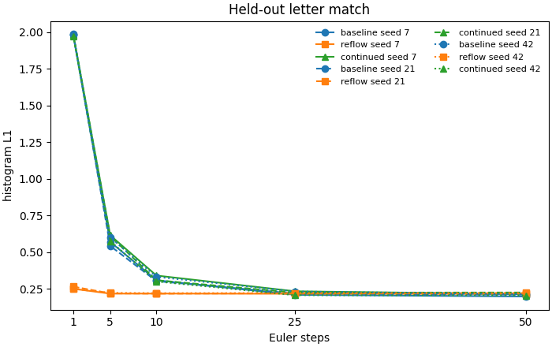

*Histogram L1 on the held-out Gaussian for all three seeds. Color is the model. Line style changes with the seed.*

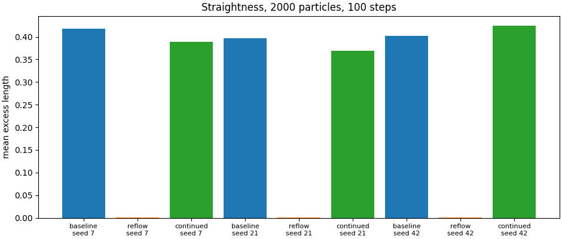

*Mean excess length on the shared 100-step grid. Blue is the baseline, orange is reflow, green is continued training.*

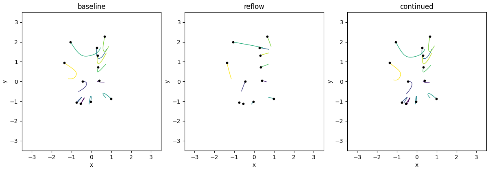

*Twelve held-out particles, seed 7, integrated with 100 Euler steps. The same starts are drawn in each panel.*

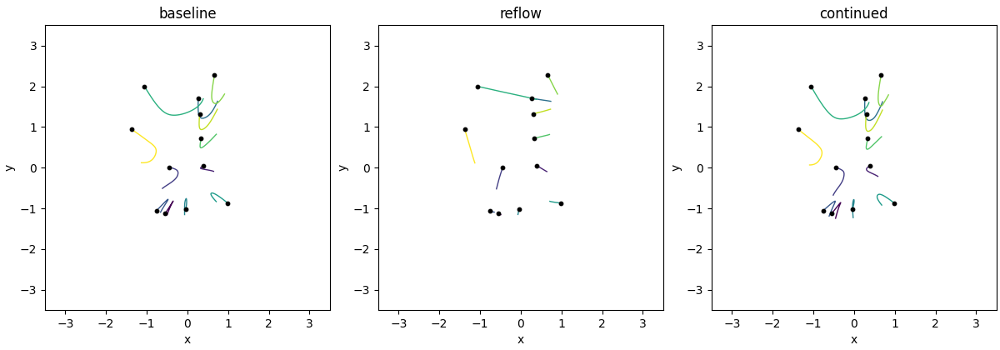

*The same kind of path plot for seed 21.*

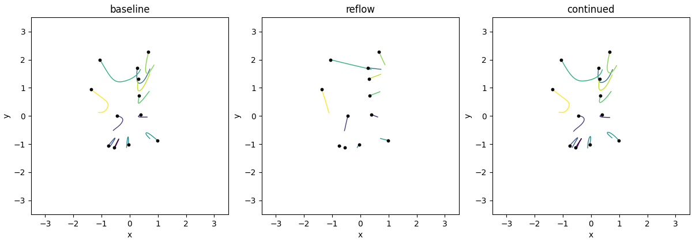

*The same kind of path plot for seed 42.*

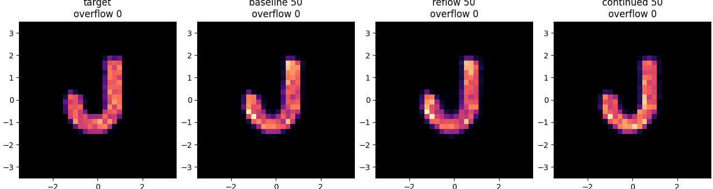

*Histogram counts at 50 Euler steps, seed 7. The title of each panel includes the overflow count.*

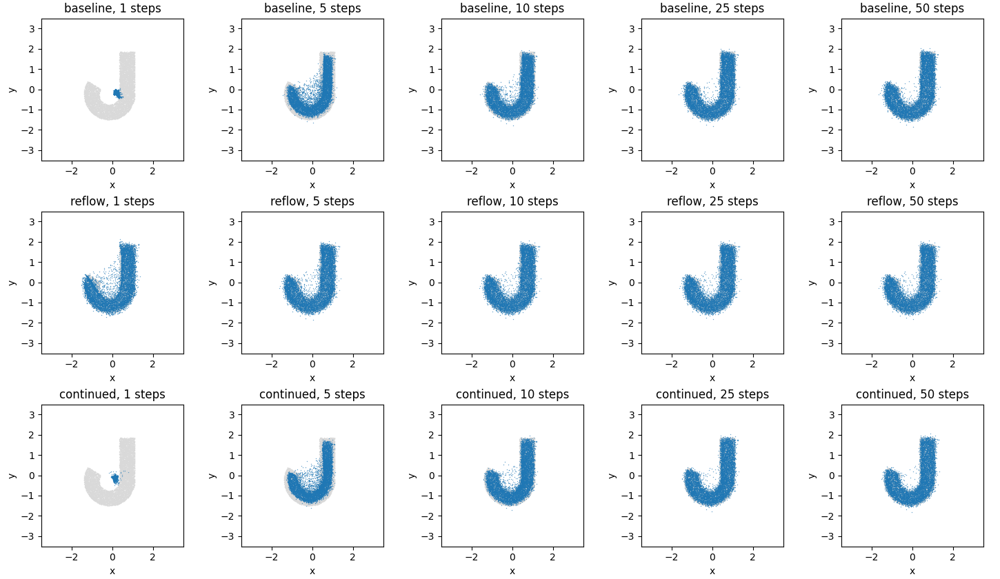

*Seed 7 clouds. Rows are baseline, reflow, and continued training. Columns are 1, 5, 10, 25, and 50 Euler steps.*

### Task 3: What the numbers support

Reflow straightens the paths on every seed. Seed 7 excess length falls from 0.418286 for the baseline to 0.000142 for reflow. Seed 21 falls from 0.396655 to 0.000160. Seed 42 falls from 0.401753 to 0.000153. On the reflow rows the polyline length and the chord agree to about three decimals, so the 100-step path is straight at the scale of this grid. Continued training does not do that. Its excess stays between 0.3690 and 0.4251. The extra 6,000 steps on the original objective leave the paths curved.

Fewer evaluations do keep most of the reflow quality. At 1 Euler step, reflow L1 is 0.2508 on seed 7, 0.2650 on seed 21, and 0.2500 on seed 42. The baseline at 1 step is 1.9788, 1.9860, and 1.9823. One reflow step also beats the baseline at 5 steps and at 10 steps on every seed. By 5 reflow steps the seed-7 L1 is 0.2175, and from 10 to 50 steps it stays between 0.2155 and 0.2180. The reflow curve is already near its plateau when each particle has been evaluated once.

A straighter path is a different claim from a closer letter. At 50 steps the baseline L1 is 0.1983 on seed 7, 0.2100 on seed 21, and 0.2137 on seed 42. Reflow at 50 steps is 0.2155, 0.2180, and 0.2223. On every seed the fine baseline solve is a little closer to the frozen letter sample than reflow is. The gaps are small next to the two-sample floor of 0.1220, and the sign is the same three times. Reflow trains on the endpoints the baseline reached, so it can copy the baseline's endpoint errors. Straightening those pairs does not remove that error. The 50-step histograms still show a J, and they still disagree with the target in the same kind of way.

Continued training is the check on whether the reflow gain is just 6,000 more updates. At 1 step its L1 stays near 2: 1.9832, 1.9812, and 1.9708. At 50 steps, seed 7 moves from 0.1983 to 0.2142, seed 21 moves from 0.2100 to 0.2253, and seed 42 moves from 0.2137 to 0.2045. Extra letter training helps the 50-step score on seed 42 and hurts it on seeds 7 and 21. It never produces the 1-step reflow score, and it never straightens the 100-step paths. The low-step gain comes from the saved pairs, not from spending the same number of extra Adam steps on the original loss.

The evidence supports the straightening half of the hypothesis on all three seeds. It supports the fewer-evaluations half when the baseline is given 1, 5, or 10 Euler steps. It does not support a claim that reflow matches the letter better than a 25- or 50-step baseline solve. On this run, reflow trades a small amount of fine-grid accuracy for a path that is already straight at one Euler step. That trade is visible in the tables. I would not call it a pure win, and I would not call it a failure of the straightening idea.

## Other saved figures

The plots above are the ones in the PDF. The same run also saved the other seeds' loss curves, clouds, and histograms.

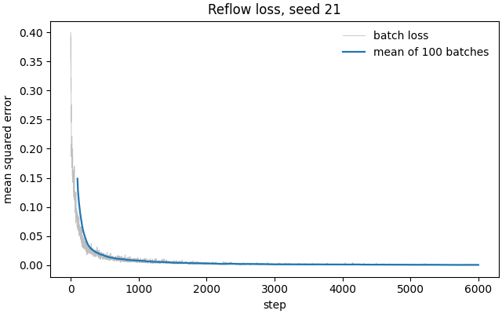

*Reflow training loss, seed 21.*

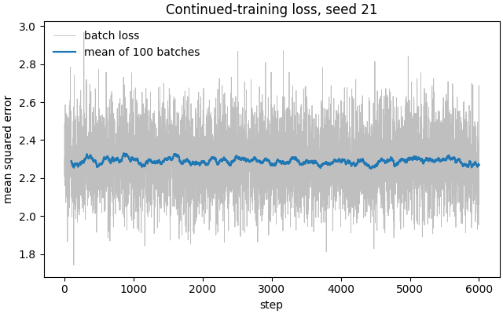

*Continued-training loss, seed 21.*

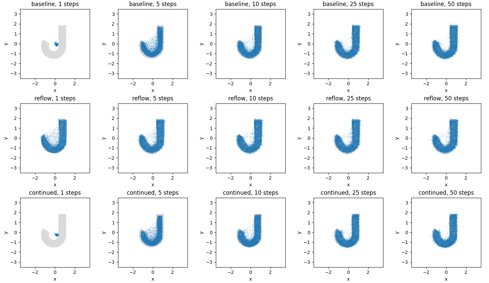

*Seed 21 clouds. Rows are baseline, reflow, and continued training.*

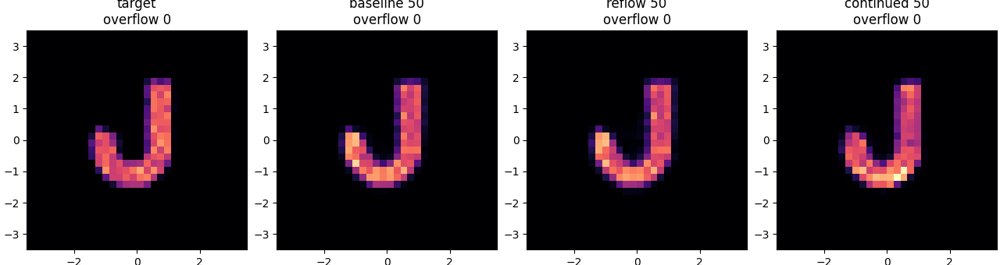

*Histogram counts at 50 Euler steps, seed 21.*

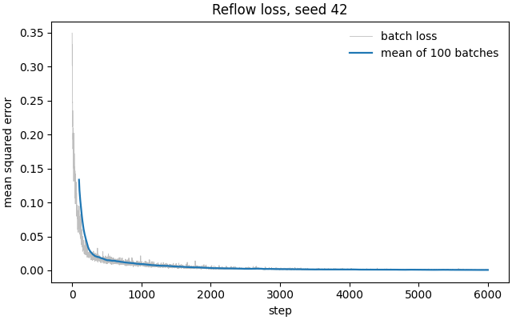

*Reflow training loss, seed 42.*

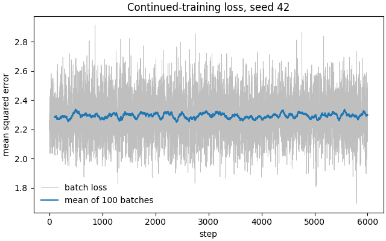

*Continued-training loss, seed 42.*

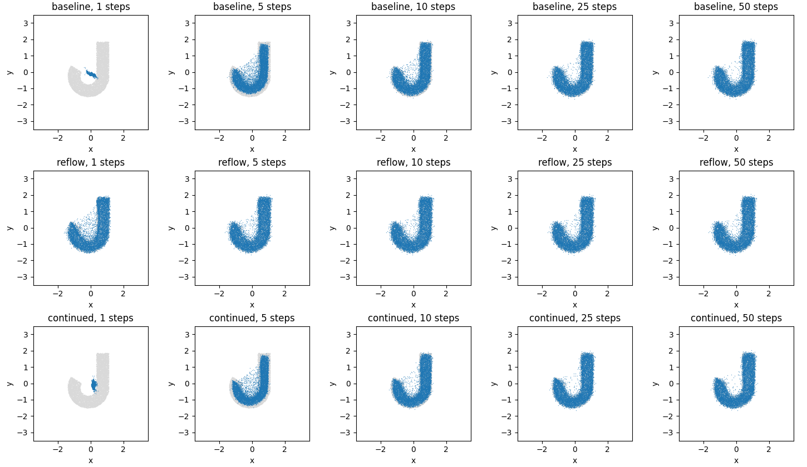

*Seed 42 clouds. Rows are baseline, reflow, and continued training.*

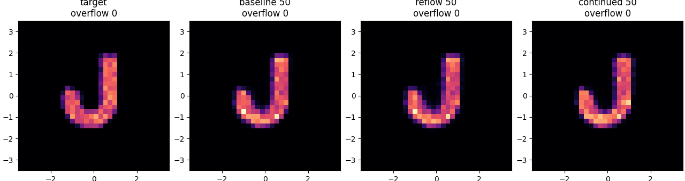

*Histogram counts at 50 Euler steps, seed 42.*

